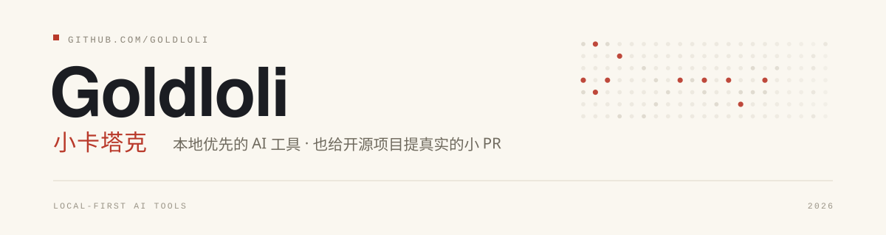

  <picture>
    <source media="(prefers-color-scheme: dark)" srcset="./assets/banner-dark.svg">
    <source media="(prefers-color-scheme: light)" srcset="./assets/banner-light.svg">
    
  </picture>

  <b>把大模型塞进本地设备里。</b> 
  本地优先（local-first）的 AI 工具作者 · 也会给开源项目提些小 PR

## 开源仓库

几个自己维护的仓库，都还在慢慢做，欢迎试用和提 issue：

- **[ASRbox](https://github.com/Goldloli/asrbox)** — 音视频转写与 AI 字幕工作台，支持 25 个本地 ASR 模型，macOS / Windows / Docker 都能跑。
- **[bilidown](https://github.com/Goldloli/bilidown)** — B 站视频、番剧、课程和音频下载工具，提供 macOS 与 Windows 桌面客户端。
- **[XiaoSeek LX04](https://github.com/Goldloli/xiaoai-deepseek-lx04)** — 在小爱触屏音箱上接入 DeepSeek 的成功尝试，老设备AI时代起死回生，保留了原生语音和米家控制。
- **[vid2note](https://github.com/Goldloli/vid2note)** — 把视频转成 Markdown 笔记和思维导图的工具。
- **[ai-sdd-bootstrap](https://github.com/Goldloli/ai-sdd-bootstrap)** — 给 AI 辅助开发用的分阶段脚手架，以前有用，现在模型能力强了没啥用。

## 开源贡献

<!-- contributions:start -->
**28** 个已合并 PR · **28** 个上游项目 · 合计 **283.2k** stars

<table>
  <tr><th align="left">项目</th><th align="right">Stars</th><th align="left">项目</th><th align="right">Stars</th><th align="left">项目</th><th align="right">Stars</th></tr>
  <tr><td><a href="https://github.com/career-ops-hq/career-ops">career-ops-hq/career-ops</a></td><td align="right">80.3k</td><td><a href="https://github.com/doocs/leetcode">doocs/leetcode</a></td><td align="right">36.8k</td><td><a href="https://github.com/docsifyjs/docsify">docsifyjs/docsify</a></td><td align="right">31.6k</td></tr>
  <tr><td><a href="https://github.com/nextai-translator/nextai-translator">nextai-translator/nextai-translator</a></td><td align="right">25k</td><td><a href="https://github.com/fishjar/kiss-translator">fishjar/kiss-translator</a></td><td align="right">13.2k</td><td><a href="https://github.com/kornia/kornia">kornia/kornia</a></td><td align="right">12.3k</td></tr>
  <tr><td><a href="https://github.com/jason5ng32/MyIP">jason5ng32/MyIP</a></td><td align="right">12.3k</td><td><a href="https://github.com/Laravel-Lang/lang">Laravel-Lang/lang</a></td><td align="right">7.8k</td><td><a href="https://github.com/supercollider/supercollider">supercollider/supercollider</a></td><td align="right">6.8k</td></tr>
  <tr><td><a href="https://github.com/KaiserY/trpl-zh-cn">KaiserY/trpl-zh-cn</a></td><td align="right">5.7k</td><td><a href="https://github.com/dromara/carbon">dromara/carbon</a></td><td align="right">5.2k</td><td><a href="https://github.com/DefectDojo/django-DefectDojo">DefectDojo/django-DefectDojo</a></td><td align="right">5.2k</td></tr>
  <tr><td><a href="https://github.com/collabora/WhisperLive">collabora/WhisperLive</a></td><td align="right">4.3k</td><td><a href="https://github.com/introlab/rtabmap">introlab/rtabmap</a></td><td align="right">4.1k</td><td><a href="https://github.com/version-fox/vfox">version-fox/vfox</a></td><td align="right">4k</td></tr>
  <tr><td><a href="https://github.com/autokey/autokey">autokey/autokey</a></td><td align="right">3.9k</td><td><a href="https://github.com/Dailin521/codex-provider-sync">Dailin521/codex-provider-sync</a></td><td align="right">3.6k</td><td><a href="https://github.com/aws-powertools/powertools-lambda-python">aws-powertools/powertools-lambda-python</a></td><td align="right">3.3k</td></tr>
  <tr><td><a href="https://github.com/hybridsjs/hybrids">hybridsjs/hybrids</a></td><td align="right">3.2k</td><td><a href="https://github.com/docmd-io/docmd">docmd-io/docmd</a></td><td align="right">2.5k</td><td><a href="https://github.com/mdn/translated-content">mdn/translated-content</a></td><td align="right">2k</td></tr>
  <tr><td><a href="https://github.com/amd/gaia">amd/gaia</a></td><td align="right">1.6k</td><td><a href="https://github.com/progit/progit2-zh">progit/progit2-zh</a></td><td align="right">1.6k</td><td><a href="https://github.com/mxsm/rocketmq-rust">mxsm/rocketmq-rust</a></td><td align="right">1.5k</td></tr>
  <tr><td><a href="https://github.com/kizuna-ai-lab/sokuji">kizuna-ai-lab/sokuji</a></td><td align="right">1.5k</td><td><a href="https://github.com/pipe-cd/pipecd">pipe-cd/pipecd</a></td><td align="right">1.4k</td><td><a href="https://github.com/blixvip/NullMotion">blixvip/NullMotion</a></td><td align="right">1.3k</td></tr>
  <tr><td><a href="https://github.com/eugenioenko/ttt">eugenioenko/ttt</a></td><td align="right">1.1k</td><td></td><td></td><td></td><td></td></tr>
</table>
<!-- contributions:end -->

## 技术栈

`Go` · `Rust` · `Python` · `TypeScript` · `C# / Avalonia` · `Tauri` · `FastAPI` · `Docker` · `SQLite` · `MLX` · `CUDA`

---

贡献表由 GitHub Actions 每天自动更新 · <a href="https://github.com/search?q=is%3Apr+is%3Amerged+author%3AGoldloli&type=pullrequests">查看全部已合并 PR</a>
