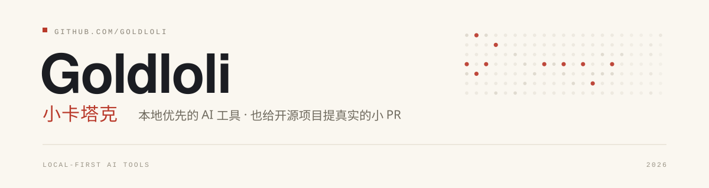
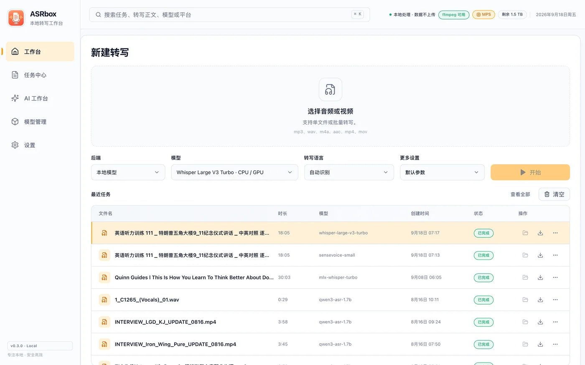
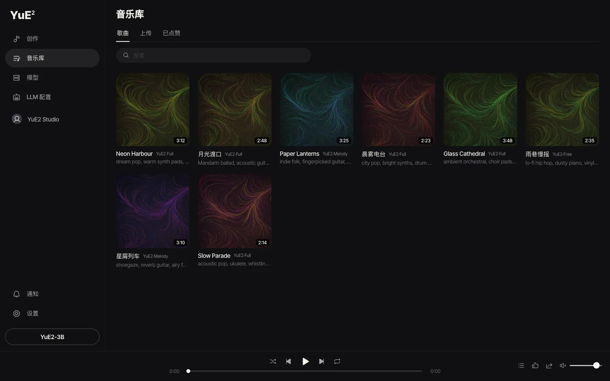

  <picture>
    <source media="(prefers-color-scheme: dark)" srcset="./assets/banner-dark.svg">
    <source media="(prefers-color-scheme: light)" srcset="./assets/banner-light.svg">
    
  </picture>

  <b>把大模型塞进本地设备里。</b> 
  本地优先（local-first）的 AI 工具作者 · 也在给开源项目提小而真实的 PR

## 精选作品

  
  

  <b>ASRbox</b> · 音视频转写与 AI 字幕工作台　　·　　<b>YuE2 Studio</b> · 本地音乐生成工作台

其他项目：[XiaoSeek LX04](https://github.com/Goldloli/xiaoai-deepseek-lx04)（Go）· [vid2note](https://github.com/Goldloli/vid2note) · [ai-sdd-bootstrap](https://github.com/Goldloli/ai-sdd-bootstrap) · [douyu-send-all-glowsticks](https://github.com/Goldloli/douyu-send-all-glowsticks)

## 开源贡献

<!-- contributions:start -->
**2** 个已合并 PR · **3** 个审核中 · **5** 个上游项目 · 合计 **66k** stars

| 项目 | Stars | 状态 | 我的贡献 |
| --- | ---: | :---: | --- |
| [doocs/leetcode](https://github.com/doocs/leetcode) | 36.7k | 已合并 | [#6253](https://github.com/doocs/leetcode/pull/6253) feat: add Rust solution for 0031. Next Permut… |
| [jason5ng32/MyIP](https://github.com/jason5ng32/MyIP) | 12.2k | 审核中 | [#540](https://github.com/jason5ng32/MyIP/pull/540) Feat(connectivity): expand China country list |
| [Laravel-Lang/lang](https://github.com/Laravel-Lang/lang) | 7.8k | 审核中 | [#8435](https://github.com/Laravel-Lang/lang/pull/8435) [zh_CN]: Added missing translations |
| [KaiserY/trpl-zh-cn](https://github.com/KaiserY/trpl-zh-cn) | 5.7k | 审核中 | [#987](https://github.com/KaiserY/trpl-zh-cn/pull/987) fix(ch15-06): clarify the translation of "whi… |
| [Dailin521/codex-provider-sync](https://github.com/Dailin521/codex-provider-sync) | 3.6k | 已合并 | [#30](https://github.com/Dailin521/codex-provider-sync/pull/30) feat: 新增 macOS Avalonia 桌面端 GUI |

数据自动更新于 2026-10-29（UTC）
<!-- contributions:end -->

## 我怎样提 PR

- **先读规则**：`CONTRIBUTING`、PR 模板、AI 使用政策、CLA / DCO——确认这条路是允许的再动手。
- **先跑通再开口**：本地测试、构建或渲染验证通过才提 PR；不做「看起来改了」的改动。
- **小步可回滚**：一个 PR 只做一件事，带上复现步骤；配合作者 review，不催合并。

## 技术栈

`Go` · `Python` · `TypeScript` · `C# / Avalonia` · `Tauri` · `FastAPI` · `Docker` · `SQLite` · `MLX` · `CUDA`

---

贡献表由 GitHub Actions 每天自动更新 · <a href="https://github.com/search?q=is%3Apr+author%3AGoldloli&type=pullrequests">查看全部 PR</a>
